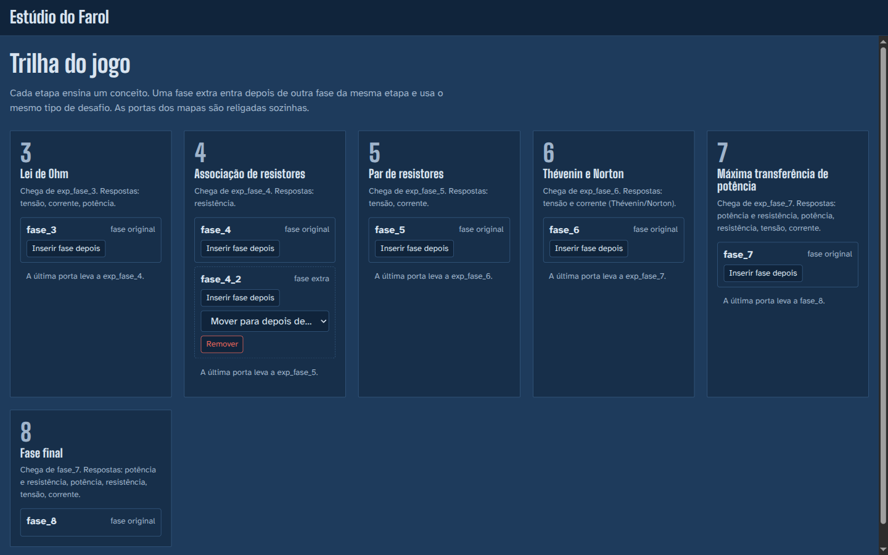
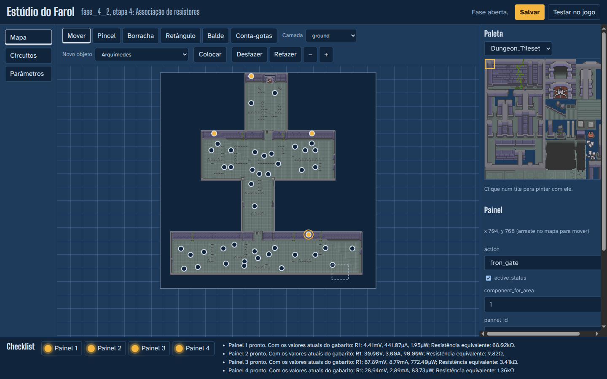
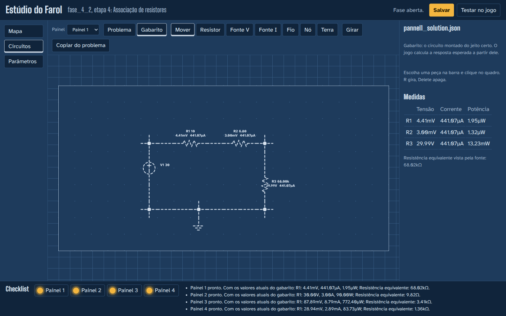
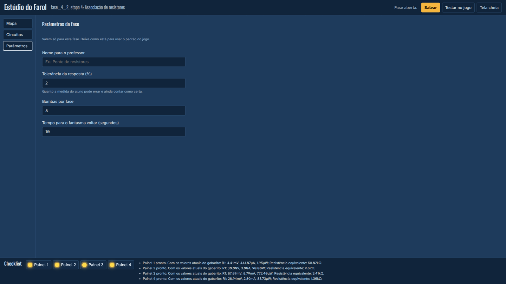

# Estúdio do Farol: guia do professor

O Estúdio do Farol é uma página no navegador para criar e ajustar as fases do jogo sem programar. Com ele você pode:

- ajustar as fases que já existem;
- criar fases extras dentro de cada etapa de conhecimento;
- desenhar o circuito-problema e o gabarito de cada painel;
- conferir tudo antes de jogar.

## Abrir

Na pasta do jogo, com as dependências instaladas (`pip install -r requirements-dev.txt`):

```bash
python tools/level_studio.py
```

O navegador abre em `http://127.0.0.1:8765/`. O estúdio só funciona neste computador. Tudo o que você salva vai direto para os arquivos do jogo:
- os mapas ficam em `assets/maps/fases`;
- os circuitos e os parâmetros ficam em `code/circuitos`.

Se usar git, cada alteração aparece no `git diff` e pode ser desfeita por lá.

No canto de cima, o botão **Ajuda** (ou a tecla `?`) explica a tela em que você está. Na primeira vez, ela abre sozinha com o passo a passo para criar uma fase.

## 1. Trilha



A tela inicial mostra as etapas na ordem em que o aluno joga:

| Etapa | Assunto |
|---|---|
| 3 | Lei de Ohm |
| 4 | Associação de resistores |
| 5 | Par de resistores |
| 6 | Thévenin e Norton |
| 7 | Máxima transferência de potência |
| 8 | Fase final |

As etapas 1 e 2 e as fases de explicação não são editáveis.

- **Inserir fase depois** cria uma fase extra logo depois daquela, na mesma etapa e com o mesmo tipo de desafio. Você escolhe se ela começa como cópia de uma fase da etapa ou com um mapa em branco, só com a porta e o jogador. As portas são religadas sozinhas: a fase anterior passa a levar para a nova, e a nova leva para onde a anterior levava.
- **Mover para depois de…** muda a posição de uma fase extra dentro da etapa.
- **Remover** apaga uma fase extra e religa a trilha. As fases originais não podem ser removidas.

O nome da fase (ex.: `fase_4_2`) também fica gravado no save do aluno. Evite renomear ou remover fases que os alunos já estão jogando.

## 2. Mapa



**Tiles**
- **Pincel**, **Borracha**, **Retângulo** e **Balde** pintam a camada escolhida em *Camada* com o tile marcado na *Paleta*.
- **Conta-gotas** copia um tile do mapa.
- As camadas `obj` são as paredes. Quando uma delas está escolhida, os blocos sólidos aparecem destacados.

**Objetos**
- **Mover** seleciona e arrasta objetos: painéis, resistores para coletar, cristais, porta, jogador, inimigos.
- As propriedades do objeto selecionado aparecem à direita.
- Para criar um objeto, escolha em **Novo objeto**, clique em **Colocar** e depois no mapa. Ele já nasce com as propriedades certas.

**Painéis** têm estas propriedades principais:

| Propriedade | O que faz |
|---|---|
| `action` | O que o painel abre ou ativa: `door`, `iron_gate`, `active` ou `bomb_bonus`. |
| `type_solution` | O que o aluno precisa acertar. A lista só mostra o que a etapa sabe validar. |
| `target_component` | O componente medido no gabarito (ex.: `R1`). |
| `component_for_area` | De qual área vêm os resistores que o aluno coleta para esse painel. O `area` dos resistores no mapa precisa ser o mesmo número. |

**Atalhos:** zoom com a roda do mouse; arrastar com Alt ou com o botão direito move a vista. Ctrl+Z desfaz e Ctrl+Y refaz.

## 3. Circuitos



Cada painel tem dois circuitos:

- **Problema**: o que o aluno encontra no painel.
- **Gabarito**: o circuito montado do jeito certo. O jogo calcula a resposta esperada a partir dele, usando os resistores que o aluno coletou.

Para montar o circuito:
- escolha a peça (Resistor, Fonte V, Fonte I, Fio, Nó, Terra) e clique no quadro;
- **R** gira a peça, e **Delete** apaga;
- em **Mover**, clique numa peça para mudar nome e valor (aceita `220`, `1k`, `4.7k`…).

Peças tracejadas são as que o aluno pode mover. Desmarque *O aluno pode mover esta peça* para fixá-las. O quadro **Medidas** mostra tensão, corrente e potência de cada resistor enquanto você edita. Se o circuito não fecha, por exemplo sem terra ou com um fio solto, o aviso diz o que falta.

**Copiar do problema** começa o gabarito a partir do problema: basta acrescentar a peça que o aluno precisa colocar.

## 4. Parâmetros



- **Tolerância**: quanto a medida do aluno pode errar e ainda contar como certa (padrão 2%).
- **Bombas por fase**: padrão 8.
- **Tempo para o fantasma voltar**: padrão 10 s.

Esses valores ficam em `code/circuitos/<etapa>/<fase>/level.json` e valem só para aquela fase.

## 5. Checklist e teste

A faixa de baixo tem uma lâmpada por painel:
- **acesa**: o painel tem os dois circuitos, o gabarito resolve, o tipo de resposta é válido na etapa e há resistores para coletar na área;
- **apagada**: o texto ao lado diz o que corrigir.

Clicar numa lâmpada abre o gabarito daquele painel.

**Salvar** (Ctrl+S) grava o mapa, o circuito aberto e os parâmetros. **Testar no jogo** salva e abre o jogo direto nessa fase. **Tela cheia** usa a tela inteira para editar; Esc sai.
